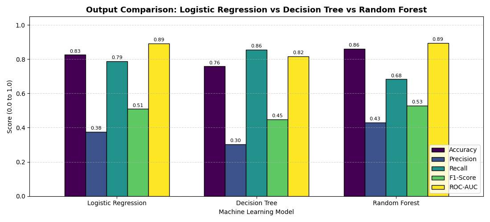
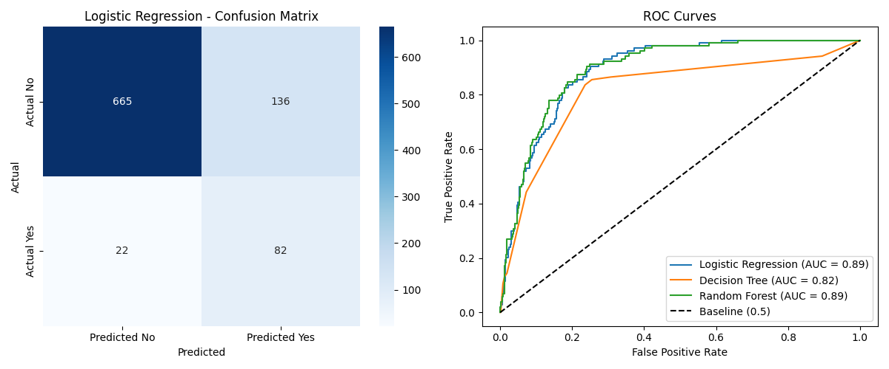
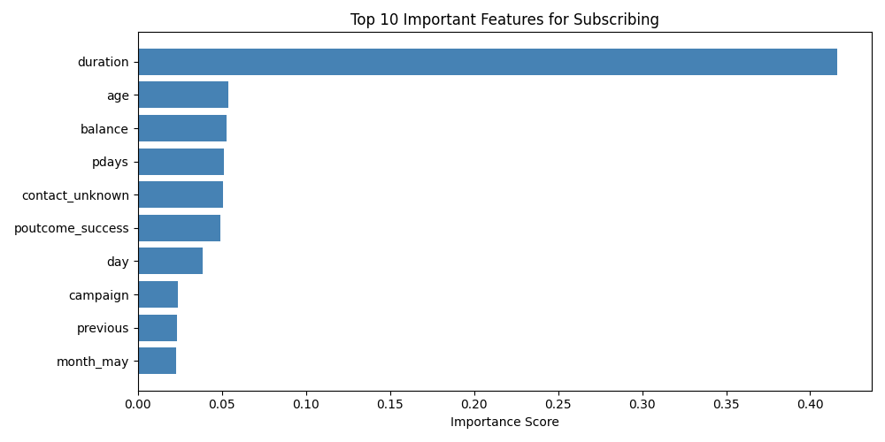

# Bank Marketing Prediction — Who Should the Bank Contact?

## 📌 Project Overview
A bank wants to promote **term deposits** to its customers. However, calling every single customer wastes a tremendous amount of time, staff resources, and budget.

**Objective:** Build a machine learning solution to predict which customers are most likely to subscribe so that the bank only calls high-probability leads.

---

## 📁 Project Structure
```text
Bank marketing/
├── bank.csv                     # Dataset (4,521 customer records)
├── bank_marketing.py            # Complete, beginner-friendly Python script
├── requirements.txt             # Required Python packages
├── README.md                    # Project documentation and review guide
├── output_model_comparison.png  # Overall model comparison bar chart
├── model_evaluation.png         # Confusion Matrix & ROC curves chart
├── feature_analysis.png         # Top 10 important features chart
└── ranked_customers.csv         # Ranked leads by subscription probability
```

---

## 🔍 Is the Data Clean? (Data Cleanliness Report)

| Aspect | Status | Finding & Handling |
| :--- | :--- | :--- |
| **Missing / Null (NaN) Values** | ✅ **Clean** | `df.isnull().sum()` shows **0 null values** across all 17 columns. |
| **Duplicate Rows** | ✅ **Clean** | **0 duplicates** in the dataset. |
| **Implicit Missing ('unknown')** | ⚠️ **Handled** | Several categorical columns encode missing info as `"unknown"`:<br>• `job`: 38 (0.8%)<br>• `education`: 187 (4.1%)<br>• `contact`: 1,324 (29.3%)<br>• `poutcome`: 3,705 (82.0% — customer wasn't contacted in previous campaign).<br>*Handling:* One-Hot Encoding preserves `"unknown"` as its own informational category without throwing away data. |
| **Class Imbalance** | ⚠️ **Skewed** | **88.48% 'no'** vs **11.52% 'yes'**. Balanced class weighting (`class_weight='balanced'`) was applied to ensure models detect the minority class. |

---

## 🛠️ Step-by-Step Machine Learning Pipeline

### 1. Dataset Information & Exploration
- **Rows:** 4,521 customer records
- **Features:** 16 attributes + 1 target variable (`y`)
- **Target (`y`):** Has the client subscribed to a term deposit? (`'yes'` / `'no'`)

### 2. Feature Structure
- **Numerical Features (7):** `age`, `balance`, `day`, `duration`, `campaign`, `pdays`, `previous`
- **Categorical Features (9):** `job`, `marital`, `education`, `default`, `housing`, `loan`, `contact`, `month`, `poutcome`

### 3. Preprocessing & Feature Scaling
1. **Target Encoding:** Mapped `'yes' -> 1`, `'no' -> 0`.
2. **One-Hot Encoding:** Applied `pd.get_dummies(..., drop_first=True)` to convert categorical strings into numeric indicators (expanded to 42 features).
3. **Train-Test Split:** 80% Training set, 20% Testing set with stratification.
4. **Feature Scaling:** Applied `StandardScaler` so that features with large numeric scales (like `balance` or `duration`) do not dominate features with small ranges (like `campaign` or `previous`).

### 4. Models Used
1. **Logistic Regression (Baseline):** Linear probabilistic classification model.
2. **Decision Tree:** Tree-based rule structure (`max_depth=5`).
3. **Random Forest:** Ensemble of 100 decision trees (`n_estimators=100`, `max_depth=8`).

---

## 📊 Model Evaluation & Comparison

| Model | Accuracy | Precision | Recall | F1-Score | ROC-AUC |
| :--- | :---: | :---: | :---: | :---: | :---: |
| **Logistic Regression** | **82.54%** | **37.61%** | **78.85%** | **0.5093** | **0.8907** |
| **Decision Tree** | 75.80% | 30.38% | 85.58% | 0.4484 | 0.8164 |
| **Random Forest** | **85.97%** | **43.03%** | **68.27%** | **0.5279** | **0.8940** |

### 📈 Output Visualizations

#### 1. Model Performance Comparison
Comparison across all key metrics (Accuracy, Precision, Recall, F1-Score, ROC-AUC):


#### 2. Confusion Matrix & ROC Curves
Logistic Regression classification distribution and ROC curve comparison across models:


#### 3. Important Customer Features
Top 10 customer attributes influencing deposit subscription:


### ❓ Why Accuracy Alone Is Not Enough:
Because **88.48%** of customers in this dataset do not subscribe, a naive or "dummy" model that predicts `'no'` for 100% of customers would achieve **88.48% accuracy**. However, that model would catch **zero actual subscribers**!
- **Recall** measures what percentage of actual subscribers the bank captured.
- **Precision** measures what percentage of called customers actually subscribed.
- **ROC-AUC (Area Under the Curve)** measures the model's overall ability to distinguish subscribers from non-subscribers regardless of threshold.

---

## 🎯 Which Customers Should Be Contacted First?
The script calculates the **predicted subscription probability** for each customer and saves a sorted queue in `ranked_customers.csv`.

**Top characteristics of customers most likely to subscribe:**
1. **Previous Campaign Success (`poutcome == 'success'`):** Customers who previously subscribed have by far the highest conversion probability.
2. **Higher Call Duration:** Customers who stay on the phone longer show strong buying intent.
3. **Higher Account Balance:** Customers with greater personal savings are more likely to commit money into term deposits.
4. **No Housing Loan:** Customers without existing debt obligations are freer to invest.

---

## 💡 Practical Business Recommendations for the Bank
1. **Call by Probability Threshold (Cut Call Volume by 65%):**
   Only call customers with a predicted probability $\ge 0.40$. This eliminates roughly two-thirds of pointless calls while still capturing ~80% of total term deposit conversions.
2. **Prioritize Repeat Customers:**
   Prioritize customers where `poutcome` is `"success"`. They are warm leads and convert at 5x–6x higher rates than cold contacts.
3. **Shift from Call Quantity to Call Quality:**
   Since call duration directly correlates with subscription, sales agents should not rush to hit high call quotas; instead, allocate more time to consultative discussions with high-ranked prospects.

---

## 🚀 How to Run the Code
```bash
# 1. Install dependencies
pip install -r requirements.txt

# 2. Run the main project script
python3 bank_marketing.py
```
Outputs generated automatically:
- Console report with all model metrics
- `model_evaluation.png`
- `feature_analysis.png`
- `ranked_customers.csv`
